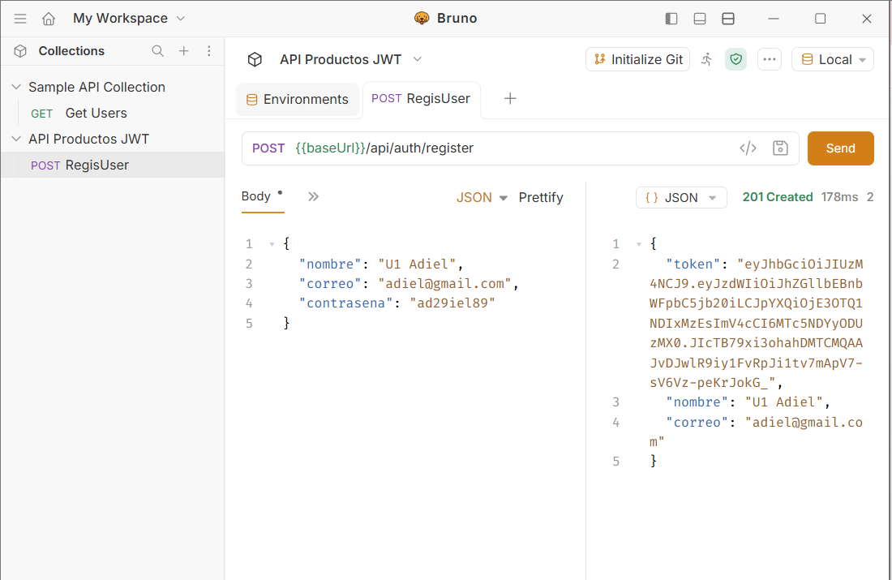
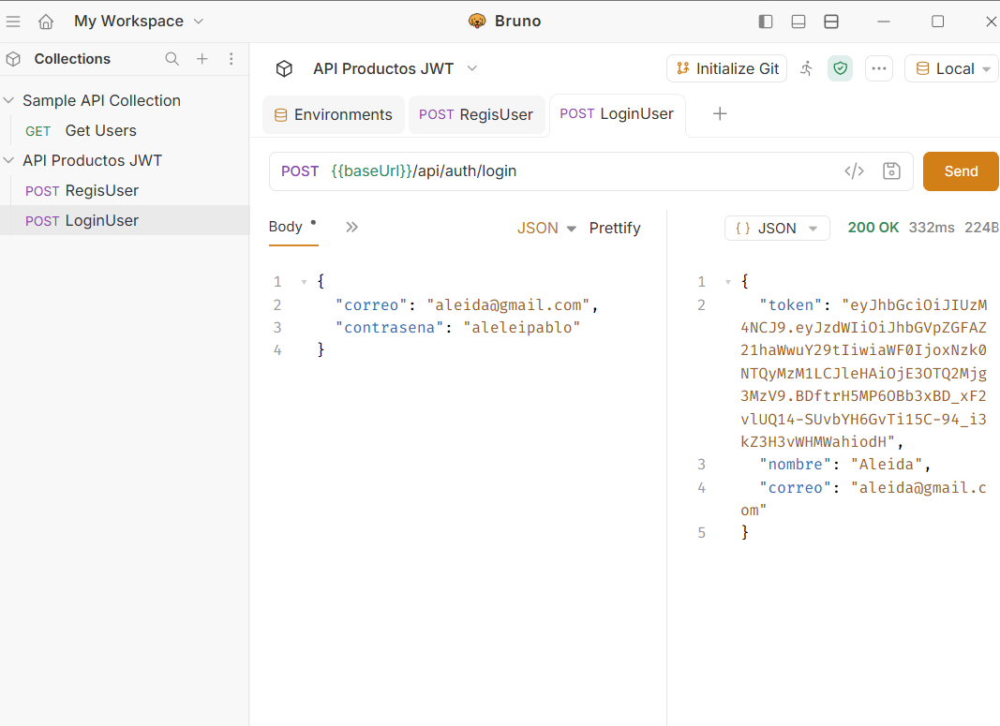
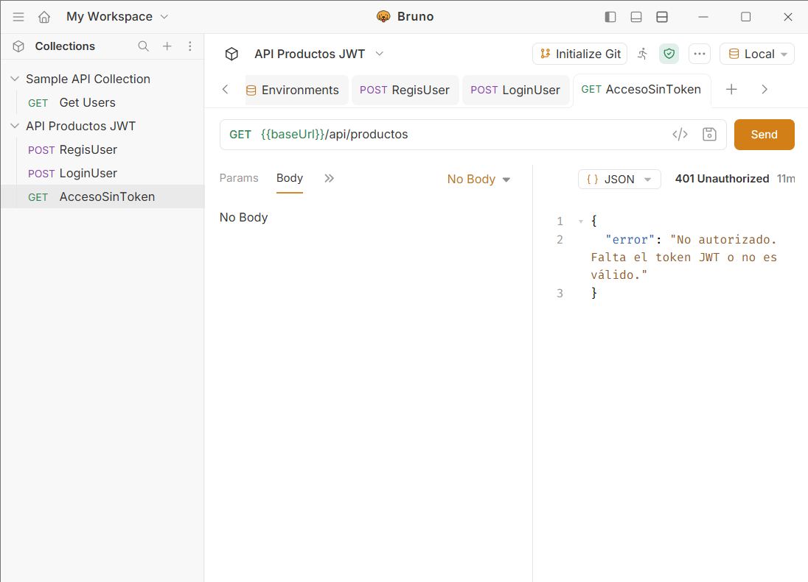
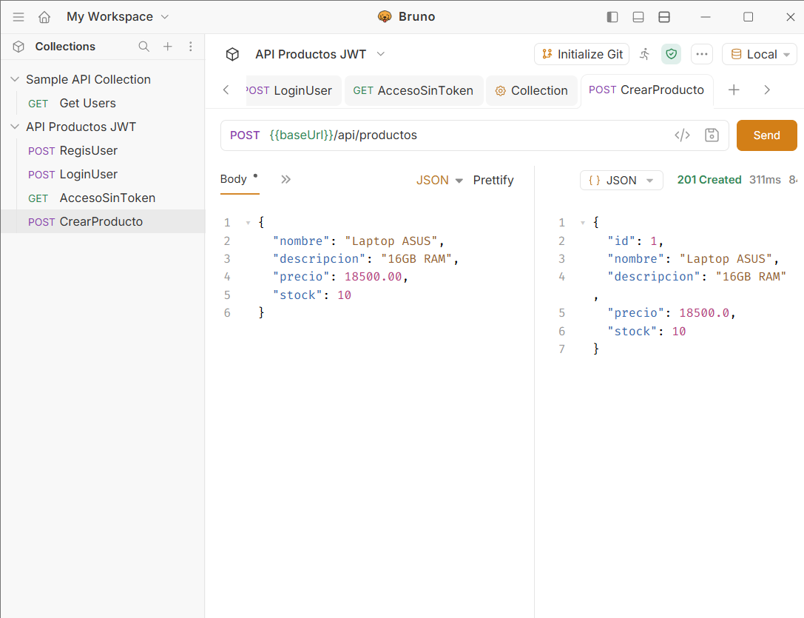
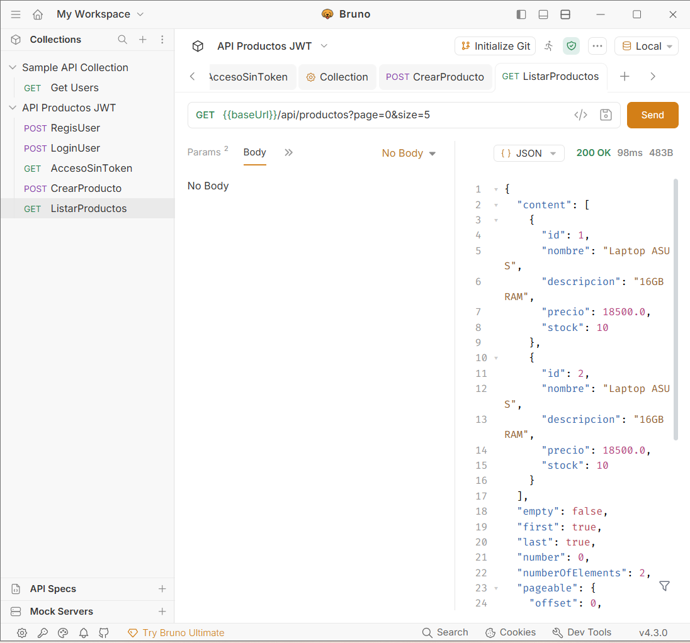
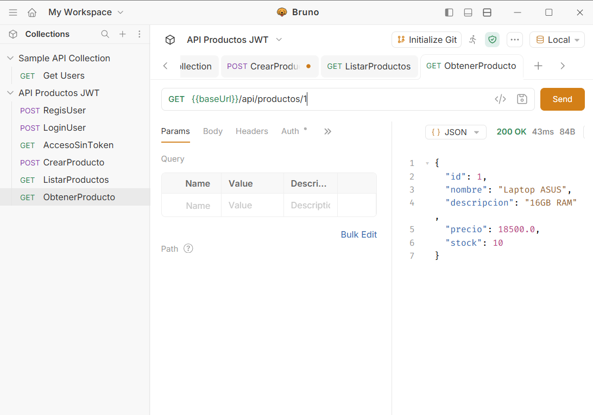
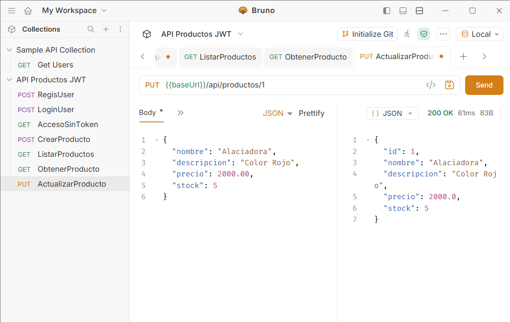
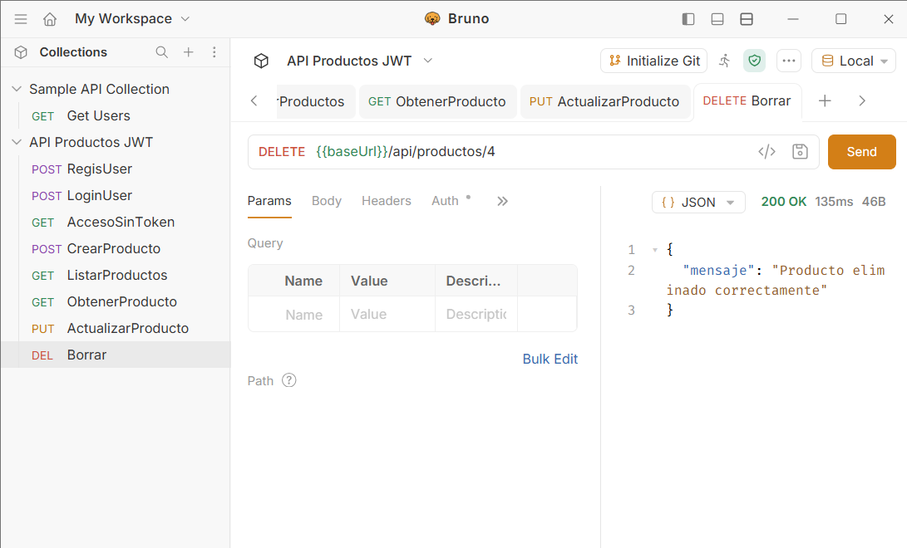

# API REST Productos con Spring Boot, JWT y MySQL

API RESTful desarrollada con **Java 21** y **Spring Boot 4.1.2** para la gestión integral (CRUD) de productos con paginación, validaciones de entrada, manejo global de excepciones y autenticación stateless basada en **JSON Web Tokens (JWT)** y **Spring Security**.

---

## Tecnologías Utilizadas

* **Lenguaje:** Java 21 (JDK 21)
* **Framework:** Spring Boot 4.1.2 (Spring Web, Spring Data JPA, Spring Security, Validation)
* **Base de Datos:** MySQL 9.x (`act4_db`)
* **Seguridad:** JWT (`jjwt`), BCryptPasswordEncoder
* **Herramientas de Prueba:** Bruno (Colección y entornos incluidos en `/bruno`)
* **Despliegue:** VPS Linux (Puerto `8085`)

---

## Arquitectura y Buenas Prácticas

El proyecto sigue una arquitectura en capas con separación clara de responsabilidades:

* **`config`**: Configuración de Spring Security (`ConfiguracionSeguridad`), beans de autenticación (`ConfiguracionAplicacion`) y manejo centralizado de errores (`ManejadorExcepcionesGlobal`).
* **`controller`**: Endpoints REST (`/api/auth` y `/api/productos`).
* **`dto`**: Objetos de Transferencia de Datos (`SolicitudRegistro`, `SolicitudLogin`, `RespuestaAutenticacion`, `SolicitudProducto`, `RespuestaProducto`) que validan los datos de entrada y garantizan que **nunca se exponga la contraseña del usuario** en las respuestas.
* **`model`**: Entidades JPA (`Usuario` y `Producto`).
* **`repository`**: Interfaces de acceso a datos con Spring Data JPA (`UsuarioRepository` y `ProductoRepository`).
* **`security`**: Filtro de validación de tokens (`JwtFiltroAutenticacion`) y servicio de generación/firma de JWT (`JwtServicio`).
* **`service`**: Lógica de negocio (`ServicioAutenticacion` y `ServicioProducto`).

---

## Endpoints de la API

### Autenticación (Rutas Públicas)

| Método | Endpoint | Descripción | Código Éxito |
| :--- | :--- | :--- | :--- |
| `POST` | `/api/auth/register` | Registra un nuevo usuario con contraseña encriptada (BCrypt) y devuelve su token JWT. | `201 Created` |
| `POST` | `/api/auth/login` | Autentica credenciales existentes y genera un nuevo token JWT. | `200 OK` |

### Productos (Rutas Protegidas — Requieren Header `Authorization: Bearer <token>`)

| Método | Endpoint | Descripción | Código Éxito |
| :--- | :--- | :--- | :--- |
| `POST` | `/api/productos` | Crea un nuevo producto validando sus campos. | `201 Created` |
| `GET` | `/api/productos?page=0&size=5` | Lista los productos de forma paginada. | `200 OK` |
| `GET` | `/api/productos/{id}` | Obtiene el detalle de un producto por su ID. | `200 OK` |
| `PUT` | `/api/productos/{id}` | Actualiza los datos de un producto existente. | `200 OK` |
| `DELETE` | `/api/productos/{id}` | Elimina un producto por su ID. | `200 OK` |

---
## Evidencias en bruno
### 1. Registro de Usuario (`201 Created`)

### 2. Inicio de Sesión / Login (`200 OK`)

### 3. Acceso Denegado sin Token JWT (`401 Unauthorized`)

### 4. Crear Producto (`201 Created`)

### 5. Listar Productos Paginados (`200 OK`)

### 6. Obtener Producto por ID (`200 OK`)

### 7. Actualizar Producto (`200 OK`)

### 8. Eliminar Producto (`200 OK`)
